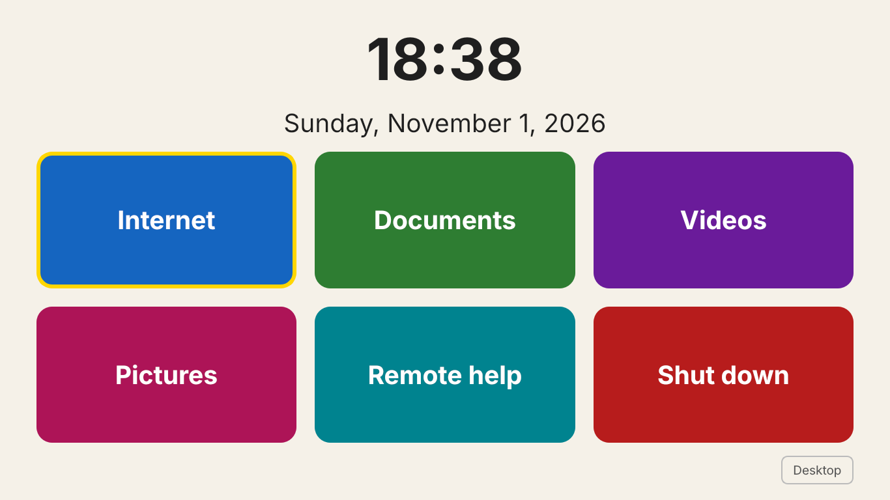
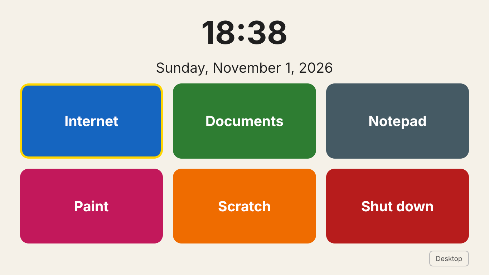

# HelloOS

*[Polska wersja](README.pl.md)*

A simple system for learning to use a computer, built on **Linux Mint XFCE** — for seniors and for primary school children. After switching the computer on you see a big clock and big buttons. Underneath is a normal Windows-like desktop (taskbar at the bottom, Start menu) for practising real everyday use.

The buttons depend on the profile:

| Profile | Buttons |
| --- | --- |
| `senior` | Internet · Documents · Videos · Pictures · Remote help · Shut down |
| `child` | Internet · Documents · Notepad · Paint · Scratch · Shut down |
| `all` (default) | all 9 buttons |

| Senior | Child |
| --- | --- |
|  |  |

**Languages:** HelloOS follows the system language. The start screen, shortcuts and installer messages are in Polish on a Polish system and in English otherwise. Linux Mint can switch the whole system language (Settings → Languages), and Chrome, LibreOffice and the other apps follow it.

## What's included

| Task | App |
| --- | --- |
| Internet | Google Chrome (Chromium as a fallback) |
| Word, Excel, PowerPoint | LibreOffice — saves as .docx / .xlsx / .pptx by default |
| Notepad | Xed (like Windows Notepad) |
| Paint | Pinta (like Paint); Tux Paint for the youngest |
| Scratch | [TurboWarp](https://desktop.turbowarp.org/) — Scratch that works offline and opens .sb3 files; without it the button opens Scratch in the browser |
| PDF | Xreader |
| Videos and music | VLC |
| Pictures | Xviewer |
| Remote help | RustDesk |

Settings: bigger text and cursor, big icons, single-click opening, a taller taskbar, no password lock screen, automatic background updates.

## Download a ready ISO

Every version is built automatically by GitHub: go to **Actions → Build ISO**, open the newest successful run and download the ISO from **Artifacts** at the bottom of the page (GitHub login required, kept for 90 days). Unzip it and write the `.iso` to a USB stick with Rufus, Balena Etcher or Ventoy — then boot from it to try HelloOS live or install it.

## Requirements

- A computer with a 64-bit Intel or AMD processor, at least 4 GB RAM and 30–40 GB of disk space
- [Linux Mint XFCE](https://linuxmint.com/download.php)
- Internet access during installation

## Installation (recommended)

1. Install Linux Mint XFCE (it can go next to Windows — see below).
2. Open a terminal and run:

```bash
git clone https://github.com/michaltobiasz/helloos.git
cd helloos
sudo ./install.sh --user grandma --profile senior --autologin
# or for a child:
sudo ./install.sh --user ola --profile child
```

- `--user NAME` — creates a separate account **without admin rights**, so nothing can be installed or removed by accident. Your own account stays the administrator.
- `--profile senior|child|all` — which buttons the start screen shows.
- `--autologin` — the computer logs this account in automatically, without a password.
- No options — sets up the account that ran the script.
- `--no-rustdesk` — skips the remote help app.

3. Restart the computer. The appearance settings apply automatically at the first login.

The script can be run many times, e.g. after pulling changes.

## Installing next to Windows

The Mint installer has an **"Install alongside Windows"** option. Windows stays untouched and a menu appears at startup to choose the system. `install.sh` makes HelloOS the default after 3 seconds.

Before installing, in Windows:

1. **Back up** important files.
2. If BitLocker / "Device encryption" is on — **save the recovery key** and suspend encryption.
3. Turn off "Fast startup" (Control Panel → Power Options → Choose what the power buttons do).
4. In "Disk Management", shrink drive C: to leave 30–40 GB free.

In the installer choose **"Install alongside Windows"** — never "Erase disk".

## Custom ISO image (experimental)

A ready-to-use USB stick with HelloOS inside:

```bash
sudo ./build-iso/build-iso.sh linuxmint-22-xfce-64bit.iso helloos.iso
```

Needs Linux and about 15 GB of space. Chrome is not built into the image (Google's licence doesn't allow it) — it installs itself on the first boot with internet access. The account created by the installer is an administrator; create the senior's or child's account afterwards with `sudo /opt/helloos/install.sh --user NAME --profile child`.

### Booting from a USB stick

Write the ISO to a USB stick (Rufus, Balena Etcher or Ventoy) and boot from it (boot menu key: usually F12, F11 or Esc). The system runs "live", without installing, and the disk with Windows stays untouched. In this mode the browser is the built-in Chromium and changes are lost at shutdown — unless you use Ventoy with persistence.

Test the ISO in VirtualBox before writing it to a USB stick. The ISO is about 4.5 GB (use a USB stick of at least 8 GB), too big for GitHub releases — share it e.g. via SourceForge.

## Changing the buttons

Buttons and profiles are defined in `TILES`, `PROFILES` and `TEXTS` (translations) in `start-screen/helloos_start.py`. You can preview the screen on any computer with Python:

```bash
pip install PyQt5
HELLOOS_LANG=en python3 start-screen/helloos_start.py --window
```

The profile comes from `~/.config/helloos/profile` (`senior`, `child` or `all`).

## Structure

```
install.sh                  main installer
start-screen/               start screen with big buttons (Python + PyQt5)
config/                     settings: Chrome, LibreOffice, file associations, boot menu
build-iso/build-iso.sh      custom ISO builder
```

## Licence

MIT — see `LICENSE`.
