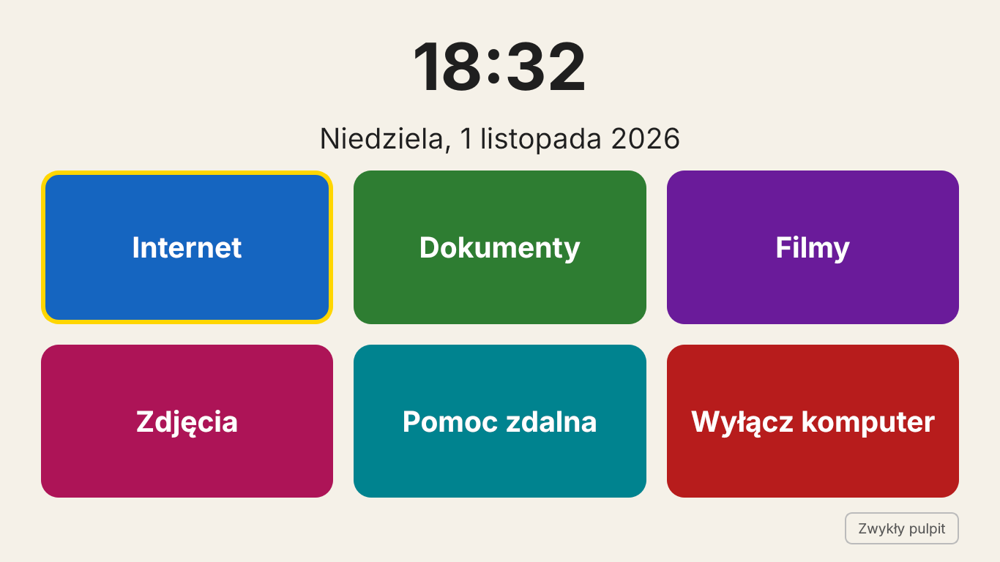

# Senior OS

Prosty system dla seniorów na bazie **Linux Mint XFCE**. Po włączeniu komputera senior widzi duży zegar i sześć dużych przycisków:

**Internet · Dokumenty · Filmy · Zdjęcia · Pomoc od rodziny · Wyłącz komputer**



Pod spodem zostaje zwykły pulpit podobny do Windowsa (pasek zadań na dole, menu Start) — dla rodziny i bardziej obytych użytkowników.

## Co zawiera

| Zadanie | Program |
| --- | --- |
| Internet | Google Chrome (zapasowo Chromium) |
| Word, Excel, PowerPoint | LibreOffice — domyślnie zapisuje w formatach .docx / .xlsx / .pptx |
| PDF | Xreader |
| Filmy i muzyka | VLC |
| Zdjęcia | Xviewer |
| Pomoc zdalna | RustDesk |

Ustawienia dla seniora: duże litery i kursor, duże ikony, otwieranie jednym kliknięciem, wyższy pasek zadań, brak blokady ekranu hasłem, automatyczne aktualizacje w tle, polskie foldery.

## Wymagania

- Komputer z 64-bitowym procesorem Intel lub AMD, min. 4 GB RAM, 30–40 GB miejsca na dysku
- [Linux Mint XFCE](https://linuxmint.com/download.php) (instalacja w języku polskim)
- Internet podczas instalacji

## Instalacja (zalecana droga)

1. Zainstaluj Linux Mint XFCE (także obok Windowsa — patrz niżej).
2. Otwórz Terminal i wpisz:

```bash
git clone https://github.com/UZYTKOWNIK/senior-os.git
cd senior-os
sudo ./install.sh --uzytkownik babcia --autologowanie
```

- `--uzytkownik babcia` — tworzy osobne konto seniora **bez uprawnień administratora** (senior nie zainstaluje ani nie usunie niczego przypadkiem). Twoje konto zostaje administratorem.
- `--autologowanie` — komputer loguje seniora sam, bez hasła.
- Bez opcji — ustawia konto, z którego uruchamiasz skrypt.
- `--bez-rustdesk` — pomija program do pomocy zdalnej.

3. Uruchom komputer ponownie. Przy pierwszym logowaniu ustawienia wyglądu nałożą się same.

Skrypt można uruchamiać wiele razy, np. po zmianach w repozytorium.

## Instalacja obok Windowsa

Instalator Minta ma opcję **„Zainstaluj obok Windows”** — Windows zostaje nietknięty, a przy starcie komputera pojawia się menu wyboru. `install.sh` ustawia w nim Senior OS jako domyślny po 3 sekundach.

Przed instalacją, w Windowsie:

1. **Zrób kopię zapasową** ważnych plików.
2. Jeśli włączony jest BitLocker / „Szyfrowanie urządzenia” — **zapisz klucz odzyskiwania** i wstrzymaj szyfrowanie.
3. Wyłącz „Szybkie uruchamianie” (Panel sterowania → Opcje zasilania → Wybierz działanie przycisków zasilania).
4. W „Zarządzaniu dyskami” zmniejsz partycję C: i zostaw 30–40 GB wolnego miejsca.

W instalatorze wybierz **„Zainstaluj obok Windows”** — nigdy „Wymaż dysk”.

## Własny obraz ISO (eksperymentalne)

Gotowy pendrive z Senior OS w środku:

```bash
sudo ./build-iso/build-iso.sh linuxmint-22-xfce-64bit.iso senior-os.iso
```

Potrzeba Linuksa i ok. 15 GB miejsca. Chrome nie jest wbudowany w obraz (nie pozwala na to licencja Google) — zainstaluje się sam przy pierwszym uruchomieniu z internetem. Konto tworzone w instalatorze jest kontem administratora; konto seniora utwórz potem przez `sudo /opt/senior-os/install.sh --uzytkownik babcia`.

### Uruchamianie z pendrive'a

Nagraj ISO na pendrive (Rufus, Balena Etcher lub Ventoy) i uruchom z niego komputer (klawisz menu rozruchu: zwykle F12, F11 lub Esc). System działa „na żywo”, bez instalacji, a dysk z Windowsem zostaje nietknięty. W tym trybie przeglądarką jest wbudowane Chromium, a zmiany znikają po wyłączeniu — chyba że użyjesz Ventoy z opcją persistence.

Przed nagraniem na pendrive przetestuj ISO w VirtualBox. Plik ISO ma ok. 3 GB, więc nie mieści się w wydaniach GitHuba — udostępnij go np. przez SourceForge.

## Zmiana przycisków

Przyciski są zdefiniowane na liście `KAFELKI` w `ekran-startowy/ekran_startowy.py`. Ekran można sprawdzić na każdym komputerze z Pythonem:

```bash
pip install PyQt5
python3 ekran-startowy/ekran_startowy.py --okno
```

## Struktura

```
install.sh                    główny skrypt instalacyjny
ekran-startowy/               ekran z dużymi przyciskami (Python + PyQt5)
konfiguracja/                 ustawienia: Chrome, LibreOffice, skojarzenia plików, menu startowe
build-iso/build-iso.sh        budowa własnego ISO
```

## Licencja

MIT — zob. plik `LICENSE`.
