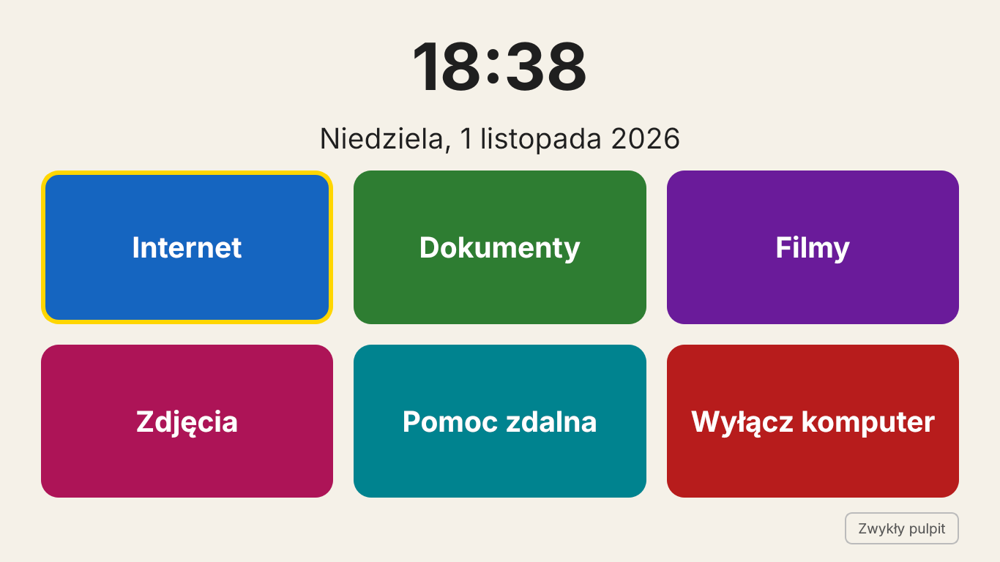
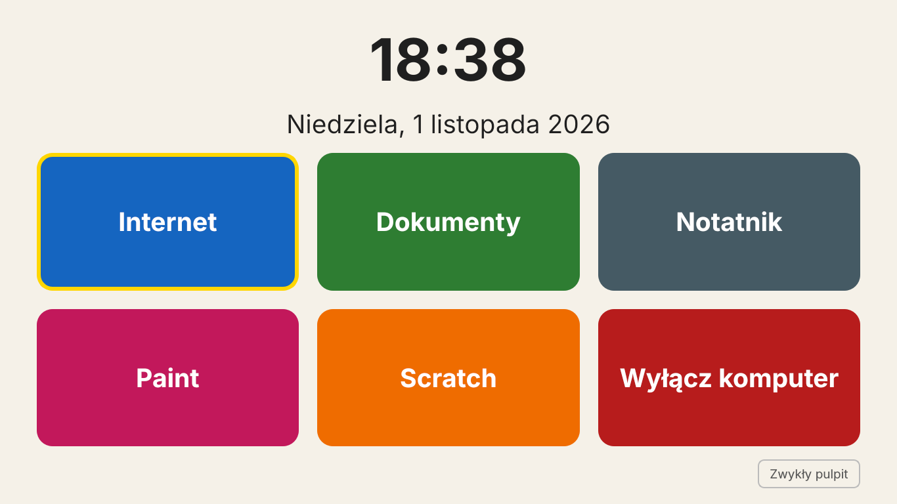

# HelloOS

*[English version](README.md)*

Prosty system do nauki obsługi komputera na bazie **Linux Mint XFCE** — dla seniorów i dla dzieci ze szkoły podstawowej. Po włączeniu komputera widać duży zegar i duże przyciski, a pod spodem zwykły pulpit podobny do Windowsa (pasek zadań na dole, menu Start), na którym można ćwiczyć prawdziwą obsługę systemu.

Przyciski zależą od profilu:

| Profil | Przyciski |
| --- | --- |
| `senior` | Internet · Dokumenty · Filmy · Zdjęcia · Pomoc zdalna · Wyłącz komputer |
| `child` (dziecko) | Internet · Dokumenty · Notatnik · Paint · Scratch · Wyłącz komputer |
| `all` (wszystko, domyślny) | wszystkie 9 przycisków |

| Senior | Dziecko |
| --- | --- |
|  |  |

**Języki:** HelloOS dopasowuje się do języka systemu. Ekran startowy, skróty i komunikaty instalatora są po polsku w polskim systemie, a w pozostałych po angielsku. Język całego systemu zmienisz w Linux Mint (Ustawienia → Języki), a Chrome, LibreOffice i inne programy przełączą się razem z nim.

## Co zawiera

| Zadanie | Program |
| --- | --- |
| Internet | Google Chrome (zapasowo Chromium) |
| Word, Excel, PowerPoint | LibreOffice — domyślnie zapisuje w formatach .docx / .xlsx / .pptx |
| Notatnik | Xed (jak Notatnik w Windowsie) |
| Paint | Pinta (jak Paint), dla najmłodszych także Tux Paint |
| Scratch | [TurboWarp](https://desktop.turbowarp.org/) — Scratch działający bez internetu, otwiera pliki .sb3; bez niego przycisk otwiera Scratch w przeglądarce |
| PDF | Xreader |
| Filmy i muzyka | VLC |
| Zdjęcia | Xviewer |
| Pomoc zdalna | RustDesk |

Ustawienia: duże litery i kursor, duże ikony, otwieranie jednym kliknięciem, wyższy pasek zadań, brak blokady ekranu hasłem, automatyczne aktualizacje w tle.

## Wymagania

- Komputer z 64-bitowym procesorem Intel lub AMD, min. 4 GB RAM, 30–40 GB miejsca na dysku
- [Linux Mint XFCE](https://linuxmint.com/download.php)
- Internet podczas instalacji

## Instalacja (zalecana droga)

1. Zainstaluj Linux Mint XFCE (także obok Windowsa — patrz niżej).
2. Otwórz Terminal i wpisz:

```bash
git clone https://github.com/michaltobiasz/helloos.git
cd helloos
sudo ./install.sh --user babcia --profile senior --autologin
# albo dla dziecka:
sudo ./install.sh --user ola --profile child
```

- `--user NAZWA` — tworzy osobne konto **bez uprawnień administratora** (senior czy dziecko nie zainstaluje ani nie usunie niczego przypadkiem). Twoje konto zostaje administratorem.
- `--profile senior|child|all` — zestaw przycisków na ekranie startowym (działają też polskie: `dziecko`, `wszystko`).
- `--autologin` — komputer loguje to konto sam, bez hasła.
- Bez opcji — ustawia konto, z którego uruchamiasz skrypt.
- `--no-rustdesk` — pomija program do pomocy zdalnej.

Działają też dawne polskie nazwy opcji: `--uzytkownik`, `--profil`, `--autologowanie`, `--bez-rustdesk`.

3. Uruchom komputer ponownie. Przy pierwszym logowaniu ustawienia wyglądu nałożą się same.

Skrypt można uruchamiać wiele razy, np. po zmianach w repozytorium.

## Instalacja obok Windowsa

Instalator Minta ma opcję **„Zainstaluj obok Windows”** — Windows zostaje nietknięty, a przy starcie komputera pojawia się menu wyboru. `install.sh` ustawia w nim HelloOS jako domyślny po 3 sekundach.

Przed instalacją, w Windowsie:

1. **Zrób kopię zapasową** ważnych plików.
2. Jeśli włączony jest BitLocker / „Szyfrowanie urządzenia” — **zapisz klucz odzyskiwania** i wstrzymaj szyfrowanie.
3. Wyłącz „Szybkie uruchamianie” (Panel sterowania → Opcje zasilania → Wybierz działanie przycisków zasilania).
4. W „Zarządzaniu dyskami” zmniejsz partycję C: i zostaw 30–40 GB wolnego miejsca.

W instalatorze wybierz **„Zainstaluj obok Windows”** — nigdy „Wymaż dysk”.

## Własny obraz ISO (eksperymentalne)

Gotowy pendrive z HelloOS w środku:

```bash
sudo ./build-iso/build-iso.sh linuxmint-22-xfce-64bit.iso helloos.iso
```

Potrzeba Linuksa i ok. 15 GB miejsca. Chrome nie jest wbudowany w obraz (nie pozwala na to licencja Google) — zainstaluje się sam przy pierwszym uruchomieniu z internetem. Konto tworzone w instalatorze jest kontem administratora; konto seniora lub dziecka utwórz potem przez `sudo /opt/helloos/install.sh --user NAZWA --profile child`.

### Uruchamianie z pendrive'a

Nagraj ISO na pendrive (Rufus, Balena Etcher lub Ventoy) i uruchom z niego komputer (klawisz menu rozruchu: zwykle F12, F11 lub Esc). System działa „na żywo”, bez instalacji, a dysk z Windowsem zostaje nietknięty. W tym trybie przeglądarką jest wbudowane Chromium, a zmiany znikają po wyłączeniu — chyba że użyjesz Ventoy z opcją persistence.

Przed nagraniem na pendrive przetestuj ISO w VirtualBox. Plik ISO ma ok. 3 GB, więc nie mieści się w wydaniach GitHuba — udostępnij go np. przez SourceForge.

## Zmiana przycisków

Przyciski, profile i tłumaczenia są w słownikach `TILES`, `PROFILES` i `TEXTS` w `start-screen/helloos_start.py`. Ekran można sprawdzić na każdym komputerze z Pythonem:

```bash
pip install PyQt5
HELLOOS_LANG=pl python3 start-screen/helloos_start.py --window
```

Profil jest zapisany w `~/.config/helloos/profile` (`senior`, `child` albo `all`).

## Struktura

```
install.sh                  główny skrypt instalacyjny
start-screen/               ekran z dużymi przyciskami (Python + PyQt5)
config/                     ustawienia: Chrome, LibreOffice, skojarzenia plików, menu startowe
build-iso/build-iso.sh      budowa własnego ISO
```

## Licencja

MIT — zob. plik `LICENSE`.
